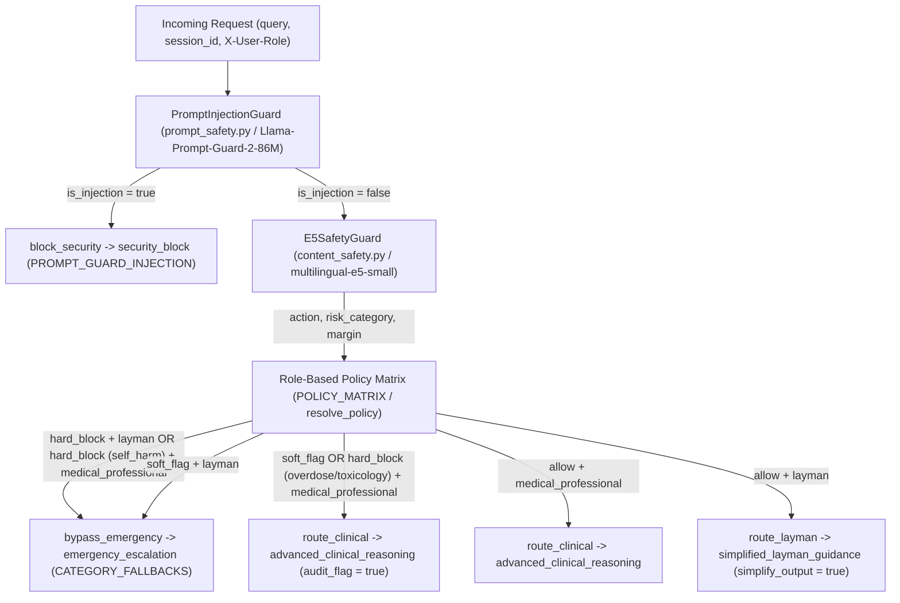
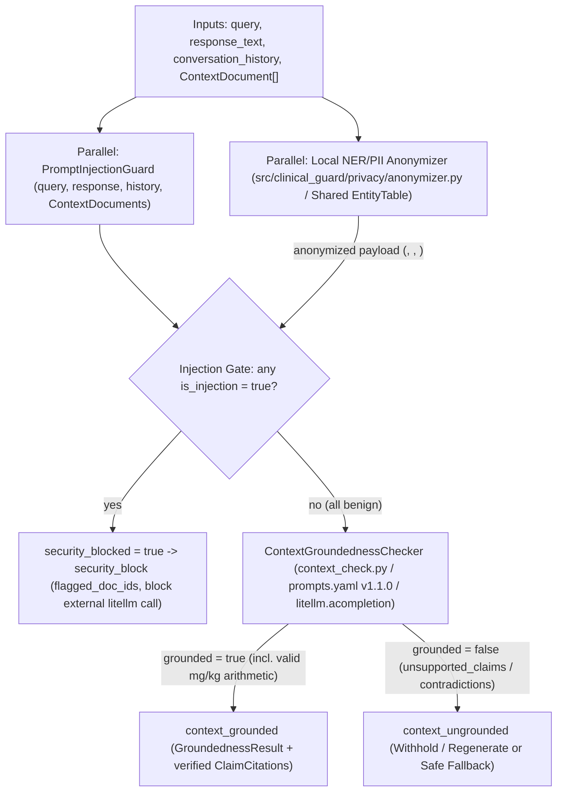
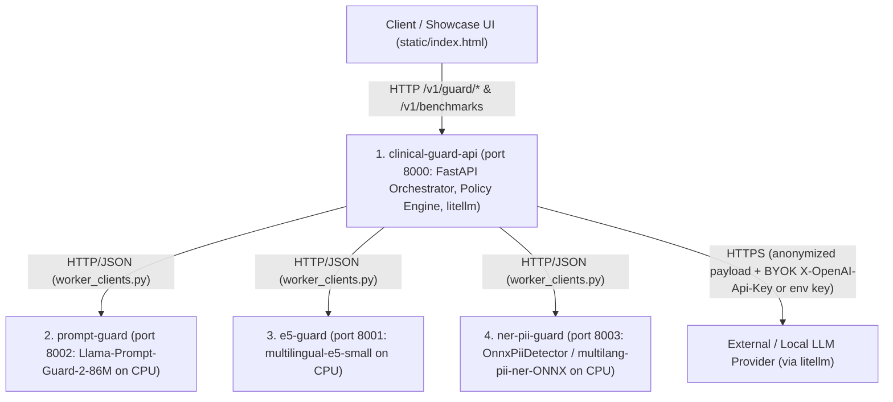

# Overall System Architecture

This document describes the end-to-end architecture of `clinical-guard`, covering the **Messages Check** pipeline (`/v1/guard/evaluate`), the **Context Groundedness Check** pipeline (`/v1/guard/evaluate_context`), and the **4-container Docker** deployment (`docker-compose.yml`).

For component-level details, see:
- [Prompt Safety Guard](prompt_safety.md) (`PromptInjectionGuard`)
- [Content Safety Guard](content_safety.md) (`E5SafetyGuard`)
- [Policy & Decision Routing](policy_architecture.md) (`POLICY_MATRIX`, `resolve_policy`)
- [Context Groundedness Check](context_check.md) (`ContextGroundednessChecker`, `run_context_pipeline`)
- [Local NER & PII Anonymization](privacy_anonymizer.md) (`LocalAnonymizer`, `EntityTable`, `OnnxPiiDetector`)
- [Docker Deployment & Configuration](deployment.md) (Single-container & 4-container setups, rate limiting, concurrency)

> **Additional Guard Endpoint:** `POST /v1/guard/prompt` reuses `run_safety_pipeline` (`PromptInjectionGuard` + `E5SafetyGuard` defense-in-depth) to return a role-independent `PromptCheckResponse` (`is_injection`, `blocked_by`, `rule_id`). All `/v1/guard/*` endpoints are protected by `SlidingWindowRateLimiter` and an `asyncio.Semaphore` inference queue (`src/clinical_guard/rate_limit.py`).

---

## 1. Messages Check Flow (`/v1/guard/evaluate`)

Incoming user messages are orchestrated by `run_safety_pipeline` (`src/clinical_guard/pipelines/safety_pipeline.py`), screened sequentially by `PromptInjectionGuard` (fast security short-circuit) and `E5SafetyGuard` (multilingual semantic crisis detection), dispatched through the role-based `POLICY_MATRIX`, and returned in `GuardResponse` with `GuardDiagnostics`.

---

## 2. Context Groundedness Check Flow (`/v1/guard/evaluate_context`)

When verifying a candidate clinical response against retrieved or uploaded reference documents (`ContextDocument(doc_id, text)`) and optional `conversation_history`, `run_context_pipeline` (`src/clinical_guard/pipelines/context_pipeline.py`) runs **Prompt Injection Screening** and **Local NER/PII Anonymization** (`src/clinical_guard/privacy/anonymizer.py`, `LocalAnonymizer` + `EntityTable`) **in parallel** via `anyio.create_task_group()` **before** calling any external LLM judge via `litellm`:

- **Injection Gate:** `PromptInjectionGuard` evaluates `query`, `response_text`, `conversation_history`, and all `ContextDocument.text` entries; if any item is flagged, the external `litellm` Groundedness API call is blocked (`security_blocked = true`, `routing_target = "security_block"`, `flagged_doc_ids`).
- **Shared Entity Table:** Local NER anonymization uses a single request-scoped **Entity Table** (`EntityTable`, e.g., `<PERSON_1>`, `<ORG_1>`, `<DATE_1>`) shared across `query`, `conversation_history`, `response_text`, and all `ContextDocument`s so the same entity receives the exact same generated ID everywhere before leaving the local boundary.
- **Citation & Entity Uncovering:** `ContextGroundednessChecker` (`context/prompts.yaml` `v1.1.0`) returns `GroundednessResult` with `ClaimCitation` entries, deterministic character-offset verification (`resolve_quote_offsets`), and uncovered entity strings.

---

## 3. 4-Container Docker Deployment (`docker-compose.yml`)

To isolate model weights, CPU memory budgets, and scaling characteristics, the repository implements a 4-container Docker Compose setup (`docker-compose.yml`, `docker/*.Dockerfile`, `src/clinical_guard/workers/`, `src/clinical_guard/clients/worker_clients.py`) separating the three local ML/privacy guards from the FastAPI orchestrator:

1. **`clinical-guard-api`** (`docker/api.Dockerfile`, port `8000`): FastAPI gateway serving `static/index.html` at `/`, `/v1/benchmarks`, `POLICY_MATRIX` dispatch, structured audit logging (`redact_query_metadata`), and `ContextGroundednessChecker` (`litellm`). Routes to worker containers when `CLINICAL_GUARD_*_GUARD_URL` env vars are set, or falls back to in-process models locally.
2. **`e5-guard`** (`docker/e5.Dockerfile`, port `8001`, `workers/e5_worker.py`): Dedicated CPU container serving `models/multilingual-e5-small` (`E5SafetyGuard`).
3. **`prompt-guard`** (`docker/prompt.Dockerfile`, port `8002`, `workers/prompt_worker.py`): Dedicated CPU container serving `models/Llama-Prompt-Guard-2-86M` (`PromptInjectionGuard`).
4. **`ner-pii-guard`** (`docker/ner.Dockerfile`, port `8003`, `workers/ner_worker.py`): Dedicated CPU container serving `models/multilang-pii-ner-ONNX` (`OnnxPiiDetector`) for local PHI/PII span detection, paired with deterministic regexes and `EntityTable` in `LocalAnonymizer`.
